  <a href="https://bcong-portfolio.pages.dev/">
    <picture>
      <source media="(max-width: 1000px) and (prefers-color-scheme: dark)" srcset="assets/hero-m-dark.svg?v=3">
      <source media="(max-width: 1000px)" srcset="assets/hero-m-light.svg?v=3">
      <source media="(prefers-color-scheme: dark)" srcset="assets/hero-dark.svg?v=3">
      
    </picture>
  </a>

  프로젝트 상세, 실제 접속 영상, 문제 해결 과정은 <a href="https://bcong-portfolio.pages.dev/"><b>포트폴리오</b></a>에서 확인하세요.

## 프로젝트

<h3>&nbsp;게임</h3>

  <a href="https://bcong-portfolio.pages.dev/projects/climax-game-server"><picture><source media="(prefers-color-scheme: dark)" srcset="assets/projects/climax-game-server-m-dark.svg?v=4"></picture></a>&nbsp;&nbsp;&nbsp;&nbsp;
  <a href="https://bcong-portfolio.pages.dev/projects/yoyang-town"><picture><source media="(prefers-color-scheme: dark)" srcset="assets/projects/yoyang-town-m-dark.svg?v=3"></picture></a>

<h3>&nbsp;웹 · 소프트웨어</h3>

  <a href="https://bcong-portfolio.pages.dev/projects/soop-chat-styler"><picture><source media="(prefers-color-scheme: dark)" srcset="assets/projects/soop-chzzk-styler-m-dark.svg?v=3"></picture></a>&nbsp;&nbsp;&nbsp;&nbsp;
  <a href="https://bcong-portfolio.pages.dev/projects/soop-vod-downloader"><picture><source media="(prefers-color-scheme: dark)" srcset="assets/projects/soop-vod-downloader-m-dark.svg?v=2"></picture></a>

  <a href="https://bcong-portfolio.pages.dev/projects/webmodbus"><picture><source media="(prefers-color-scheme: dark)" srcset="assets/projects/webmodbus-m-dark.svg"></picture></a>&nbsp;&nbsp;&nbsp;&nbsp;
  <a href="https://bcong-portfolio.pages.dev/#projects"><picture><source media="(prefers-color-scheme: dark)" srcset="assets/projects/coupon-alert-bot-m-dark.svg?v=2"></picture></a>

  그 밖의 프로젝트와 전체 목록은 <a href="https://bcong-portfolio.pages.dev/#projects"><b>포트폴리오</b></a>에서 볼 수 있습니다.

## 연락처

<a href="https://bcong-portfolio.pages.dev/"><picture><source media="(prefers-color-scheme: dark)" srcset="assets/contact/portfolio-dark.svg"></picture></a><a href="mailto:bcong9455@gmail.com"><picture><source media="(prefers-color-scheme: dark)" srcset="assets/contact/gmail-dark.svg"></picture></a> 
<a href="mailto:sudn_@naver.com"><picture><source media="(prefers-color-scheme: dark)" srcset="assets/contact/naver-dark.svg"></picture></a><a href="https://velog.io/@bcong"><picture><source media="(prefers-color-scheme: dark)" srcset="assets/contact/velog-dark.svg"></picture></a>

  © 2026 GyeongSeop Kim

