

  <a href="https://bcong-portfolio.pages.dev/">
    <picture>
      <source media="(max-width: 1000px) and (prefers-color-scheme: dark)" srcset="assets/hero-m-dark.svg">
      <source media="(max-width: 1000px)" srcset="assets/hero-m-light.svg">
      <source media="(prefers-color-scheme: dark)" srcset="assets/hero-dark.svg">
      
    </picture>
  </a>

  프로젝트 상세, 실제 접속 영상, 문제 해결 과정은 <a href="https://bcong-portfolio.pages.dev/"><b>포트폴리오</b></a>에서 확인하세요.

## 프로젝트

<h3 align="center">게임</h3>

  <a href="https://bcong-portfolio.pages.dev/projects/climax-game-server"><picture><source media="(prefers-color-scheme: dark)" srcset="assets/projects/climax-game-server-m-dark.svg"></picture></a>
  <a href="https://bcong-portfolio.pages.dev/projects/yoyang-town"><picture><source media="(prefers-color-scheme: dark)" srcset="assets/projects/yoyang-town-m-dark.svg"></picture></a>

<h3 align="center">웹</h3>

  <a href="https://bcong-portfolio.pages.dev/projects/soop-chat-styler"><picture><source media="(prefers-color-scheme: dark)" srcset="assets/projects/soop-chzzk-styler-m-dark.svg"></picture></a>
  <a href="https://bcong-portfolio.pages.dev/projects/soop-vod-downloader"><picture><source media="(prefers-color-scheme: dark)" srcset="assets/projects/soop-vod-downloader-m-dark.svg"></picture></a>
  <a href="https://bcong-portfolio.pages.dev/projects/webmodbus"><picture><source media="(prefers-color-scheme: dark)" srcset="assets/projects/webmodbus-m-dark.svg"></picture></a>
  <a href="https://bcong-portfolio.pages.dev/#projects"><picture><source media="(prefers-color-scheme: dark)" srcset="assets/projects/coupon-alert-bot-m-dark.svg"></picture></a>

  그 밖의 프로젝트와 전체 목록은 <a href="https://bcong-portfolio.pages.dev/#projects"><b>포트폴리오</b></a>에서 볼 수 있습니다.

## 기술 스택

  <b>언어</b> 
  <a href="https://www.typescriptlang.org/" title="TypeScript · 타입을 더한 JavaScript"><picture><source media="(prefers-color-scheme: dark)" srcset="assets/icons/dark/typescript.svg"></picture></a>&nbsp;&nbsp;<a href="https://developer.mozilla.org/docs/Web/JavaScript" title="JavaScript · 웹과 서버에서 쓰는 스크립트 언어"><picture><source media="(prefers-color-scheme: dark)" srcset="assets/icons/dark/javascript.svg">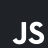</picture></a>&nbsp;&nbsp;<a href="https://learn.microsoft.com/dotnet/csharp/" title="C# · .NET 기반 객체지향 언어"><picture><source media="(prefers-color-scheme: dark)" srcset="assets/icons/dark/csharp.svg"></picture></a>&nbsp;&nbsp;<a href="https://www.lua.org/" title="Lua · 경량 스크립트 언어, FiveM 리소스 개발"><picture><source media="(prefers-color-scheme: dark)" srcset="assets/icons/dark/lua.svg">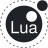</picture></a>

  <b>프론트엔드</b> 
  <a href="https://developer.mozilla.org/docs/Web/HTML" title="HTML5 · 웹 문서 구조를 정의하는 마크업"><picture><source media="(prefers-color-scheme: dark)" srcset="assets/icons/dark/html5.svg"></picture></a>&nbsp;&nbsp;<a href="https://developer.mozilla.org/docs/Web/CSS" title="CSS3 · 화면의 스타일과 레이아웃"><picture><source media="(prefers-color-scheme: dark)" srcset="assets/icons/dark/css3.svg">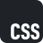</picture></a>&nbsp;&nbsp;<a href="https://sass-lang.com/" title="Sass · 변수와 중첩을 지원하는 CSS 전처리기"><picture><source media="(prefers-color-scheme: dark)" srcset="assets/icons/dark/sass.svg"></picture></a>&nbsp;&nbsp;<a href="https://lesscss.org/" title="Less · 변수와 믹스인을 지원하는 CSS 전처리기"><picture><source media="(prefers-color-scheme: dark)" srcset="assets/icons/dark/less.svg"></picture></a>&nbsp;&nbsp;<a href="https://tailwindcss.com/" title="Tailwind CSS · 유틸리티 클래스 기반 CSS"><picture><source media="(prefers-color-scheme: dark)" srcset="assets/icons/dark/tailwindcss.svg"></picture></a>&nbsp;&nbsp;<a href="https://react.dev/" title="React · 컴포넌트 기반 UI 라이브러리"><picture><source media="(prefers-color-scheme: dark)" srcset="assets/icons/dark/react.svg"></picture></a>&nbsp;&nbsp;<a href="https://mobx.js.org/" title="MobX · 관찰 가능한 상태를 반영하는 상태 관리"><picture><source media="(prefers-color-scheme: dark)" srcset="assets/icons/dark/mobx.svg"></picture></a>&nbsp;&nbsp;<a href="https://vite.dev/" title="Vite · 빠른 개발 서버와 번들러"><picture><source media="(prefers-color-scheme: dark)" srcset="assets/icons/dark/vite.svg"></picture></a>&nbsp;&nbsp;<a href="https://nextjs.org/" title="Next.js · React 기반 풀스택 프레임워크"><picture><source media="(prefers-color-scheme: dark)" srcset="assets/icons/dark/nextjs.svg"></picture></a>&nbsp;&nbsp;<a href="https://jquery.com/" title="jQuery · DOM 조작과 이벤트 처리 라이브러리"><picture><source media="(prefers-color-scheme: dark)" srcset="assets/icons/dark/jquery.svg"></picture></a>&nbsp;&nbsp;<a href="https://axios-http.com/" title="Axios · HTTP 요청 클라이언트"><picture><source media="(prefers-color-scheme: dark)" srcset="assets/icons/dark/axios.svg"></picture></a>

  <b>백엔드</b> 
  <a href="https://nodejs.org/" title="Node.js · 자바스크립트 서버 런타임"><picture><source media="(prefers-color-scheme: dark)" srcset="assets/icons/dark/nodejs.svg"></picture></a>&nbsp;&nbsp;<a href="https://nestjs.com/" title="NestJS · TypeScript 기반 서버 프레임워크"><picture><source media="(prefers-color-scheme: dark)" srcset="assets/icons/dark/nestjs.svg"></picture></a>&nbsp;&nbsp;<a href="https://expressjs.com/" title="Express · Node.js 웹 서버 프레임워크"><picture><source media="(prefers-color-scheme: dark)" srcset="assets/icons/dark/express.svg"></picture></a>&nbsp;&nbsp;<a href="https://socket.io/" title="Socket.IO · 실시간 양방향 통신"><picture><source media="(prefers-color-scheme: dark)" srcset="assets/icons/dark/socketio.svg"></picture></a>&nbsp;&nbsp;<a href="https://webrtc.org/" title="WebRTC · 브라우저 간 실시간 음성·영상·데이터"><picture><source media="(prefers-color-scheme: dark)" srcset="assets/icons/dark/webrtc.svg"></picture></a>

  <b>데이터베이스</b> 
  <a href="https://www.mysql.com/" title="MySQL · 널리 쓰이는 관계형 데이터베이스"><picture><source media="(prefers-color-scheme: dark)" srcset="assets/icons/dark/mysql.svg"></picture></a>&nbsp;&nbsp;<a href="https://mariadb.org/" title="MariaDB · MySQL 계열 관계형 데이터베이스"><picture><source media="(prefers-color-scheme: dark)" srcset="assets/icons/dark/mariadb.svg"></picture></a>&nbsp;&nbsp;<a href="https://sqlite.org/" title="SQLite · 파일 하나로 동작하는 경량 DB"><picture><source media="(prefers-color-scheme: dark)" srcset="assets/icons/dark/sqlite.svg"></picture></a>&nbsp;&nbsp;<a href="https://www.mongodb.com/" title="MongoDB · 문서 기반 NoSQL 데이터베이스"><picture><source media="(prefers-color-scheme: dark)" srcset="assets/icons/dark/mongodb.svg"></picture></a>&nbsp;&nbsp;<a href="https://redis.io/" title="Redis · 메모리 기반 캐시와 키-값 저장소"><picture><source media="(prefers-color-scheme: dark)" srcset="assets/icons/dark/redis.svg"></picture></a>

  <b>앱 · 봇</b> 
  <a href="https://www.electronjs.org/" title="Electron · 웹 기술로 데스크톱 앱 개발"><picture><source media="(prefers-color-scheme: dark)" srcset="assets/icons/dark/electron.svg">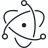</picture></a>&nbsp;&nbsp;<a href="https://developer.chrome.com/docs/extensions/" title="Chrome 확장 프로그램 · MV3 개발"><picture><source media="(prefers-color-scheme: dark)" srcset="assets/icons/dark/googlechrome.svg"></picture></a>&nbsp;&nbsp;<a href="https://discord.com/developers/docs/intro" title="Discord · 봇과 슬래시 명령어 플랫폼"><picture><source media="(prefers-color-scheme: dark)" srcset="assets/icons/dark/discord.svg"></picture></a>

  <b>인프라 · 도구</b> 
  <a href="https://www.docker.com/" title="Docker · 컨테이너로 실행 환경을 묶어 배포"><picture><source media="(prefers-color-scheme: dark)" srcset="assets/icons/dark/docker.svg"></picture></a>&nbsp;&nbsp;<a href="https://git-scm.com/" title="Git · 분산 버전 관리 시스템"><picture><source media="(prefers-color-scheme: dark)" srcset="assets/icons/dark/git.svg"></picture></a>&nbsp;&nbsp;<a href="https://nginx.org/" title="nginx · 웹 서버와 리버스 프록시"><picture><source media="(prefers-color-scheme: dark)" srcset="assets/icons/dark/nginx.svg"></picture></a>&nbsp;&nbsp;<a href="https://pages.cloudflare.com/" title="Cloudflare · CDN과 Pages 배포"><picture><source media="(prefers-color-scheme: dark)" srcset="assets/icons/dark/cloudflare.svg"></picture></a>&nbsp;&nbsp;<a href="https://www.figma.com/" title="Figma · UI 디자인과 프로토타이핑"><picture><source media="(prefers-color-scheme: dark)" srcset="assets/icons/dark/figma.svg"></picture></a>

  아이콘에 마우스를 올리면 설명이 나오고, 클릭하면 공식 사이트로 이동합니다. 사용 맥락은 <a href="https://bcong-portfolio.pages.dev/#skills"><b>포트폴리오</b></a>에서 확인하세요.

## 연락처

  <a href="https://bcong-portfolio.pages.dev/"><b>포트폴리오</b></a> · bcong-portfolio.pages.dev 
  <a href="mailto:bcong9455@gmail.com"><b>Gmail</b></a> · bcong9455@gmail.com 
  <a href="mailto:sudn_@naver.com"><b>네이버 메일</b></a> · sudn_@naver.com 
  <a href="https://velog.io/@bcong"><b>Velog</b></a> · velog.io/@bcong

  © 2026 GyeongSeop Kim

