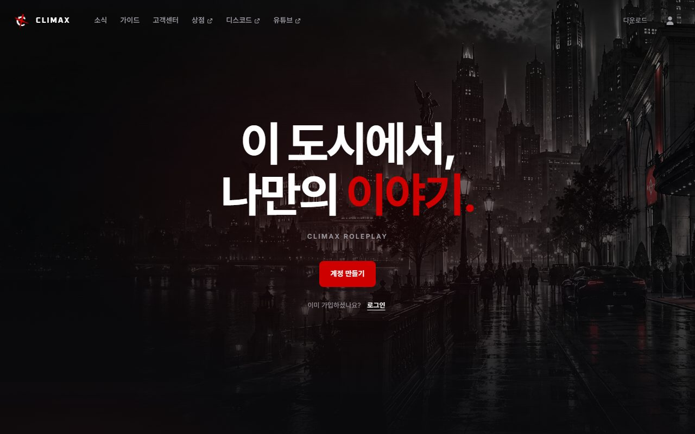
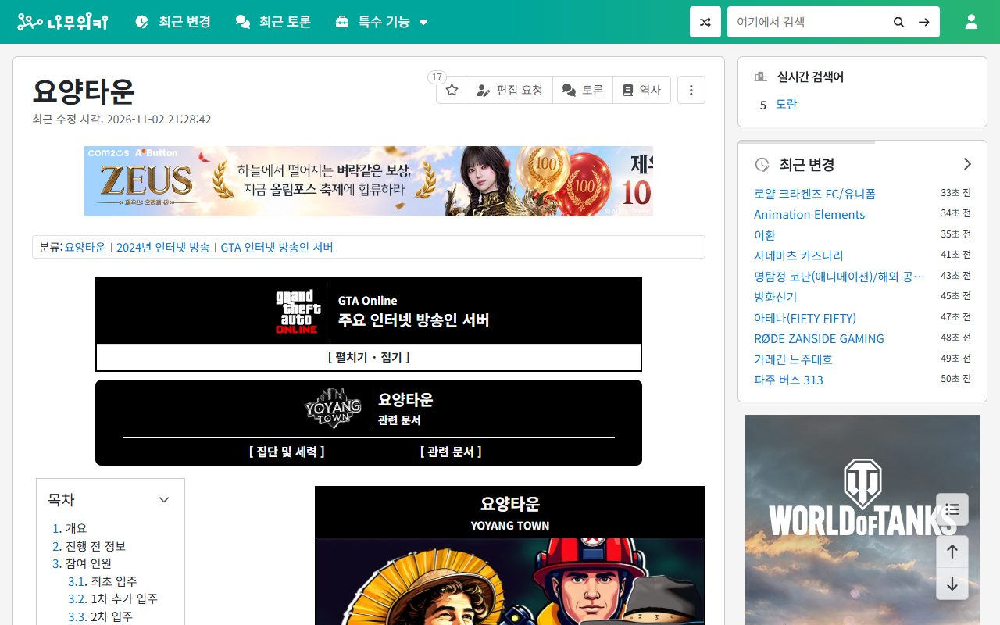
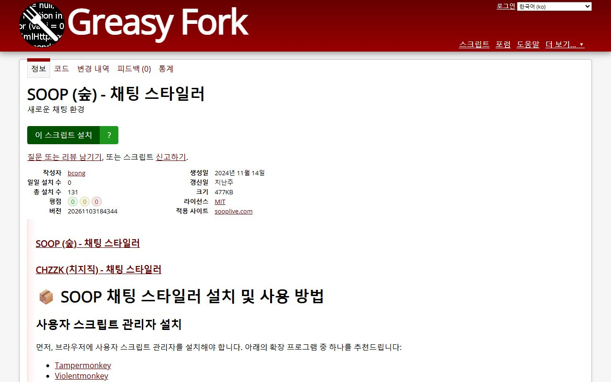
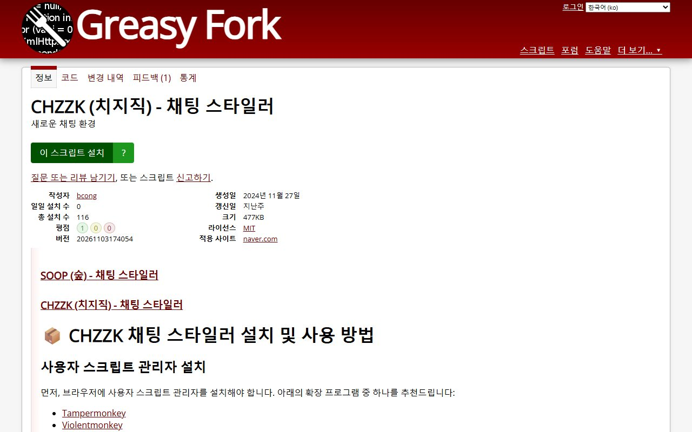
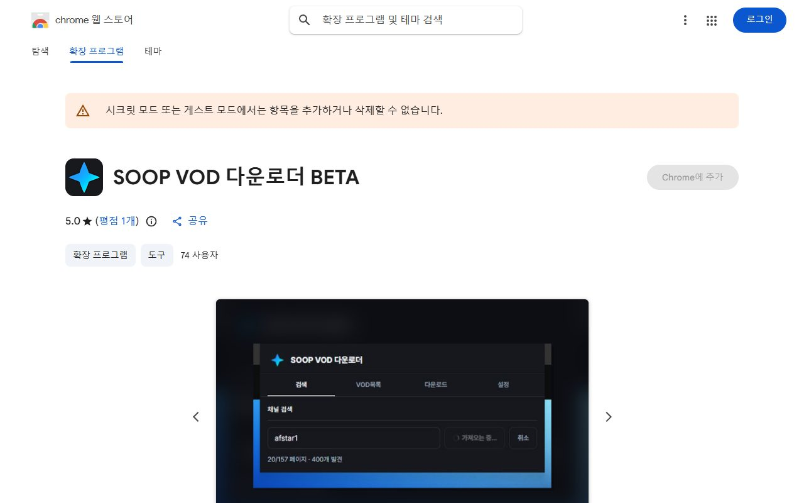
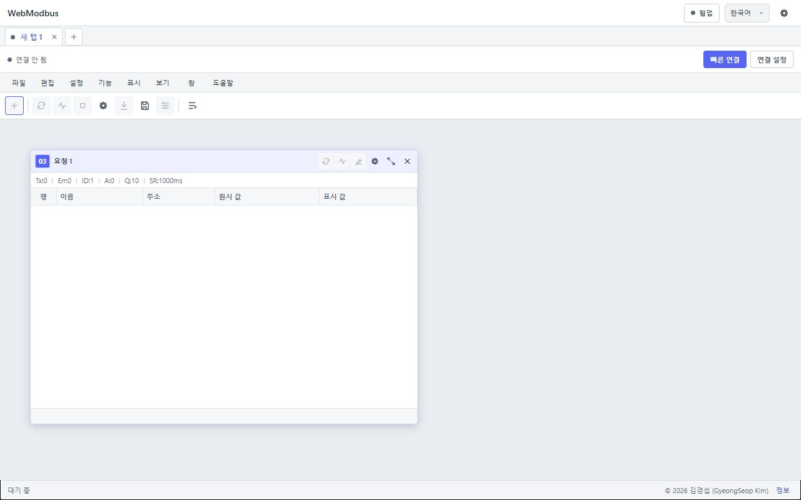
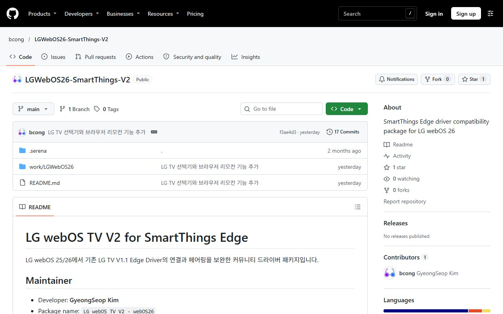

  <a href="https://bcong-portfolio.pages.dev/">
    <picture>
      <source media="(max-width: 1000px) and (prefers-color-scheme: dark)" srcset="assets/hero-m-dark.svg">
      <source media="(max-width: 1000px)" srcset="assets/hero-m-light.svg">
      <source media="(prefers-color-scheme: dark)" srcset="assets/hero-dark.svg">
      
    </picture>
  </a>

  프로젝트 상세, 실제 접속 영상, 문제 해결 과정은 <a href="https://bcong-portfolio.pages.dev/"><b>포트폴리오</b></a>에서 확인하세요.

## 프로젝트

카드를 펼치면 역할, 사용 기술, 성과와 문제 해결 과정을 볼 수 있습니다. 실제 접속 화면과 자세한 내용은 포트폴리오에서 확인하세요.

### 게임 서버

<b>CLIMAX 게임 서버</b> · FiveM · Qbox · 동시접속 90명 이상

  

과거 국내 1위 서버 운영 경험을 살려 외주로 구축한 FiveM 롤플레이 서버입니다. 직업·경제·차량·휴대폰 등 100개 이상의 커스텀 리소스를 도메인별 폴더로 나눠 관리합니다.

`FiveM` `Qbox` `ox_lib` `Redis` `NUI` `txAdmin` `nginx` `systemd`

- **성과** 동시접속 90명 이상 달성, 장애 때 수동으로 하던 재시작과 캐시 정리를 스크립트로 대체
- **문제 → 해결** 같은 export가 여러 리소스에 중복 등록됨 → 래퍼 계층과 공용 유틸로 프레임워크 호출을 한곳에 모음
- **문제 → 해결** 데이터 조회가 DB로 몰리는 부하 → Redis 캐시 계층과 캐시 점검 도구 도입

[포트폴리오 상세 보기 →](https://bcong-portfolio.pages.dev/projects/climax-game-server) · [CLIMAX 공식 홈페이지](https://cmx.gg/)

<b>요양타운 GTA5 스트리머 서버</b> · SOOP 인터넷 방송 · 누적 시청자 약 890만 명

  

SOOP·인터넷 방송 최초의 GTA5 스트리머 롤플레이 서버에서 개발진으로 참여했습니다. QBCore 기반으로 180개 리소스를 구성하고 운영 기능을 맡았습니다.

`FiveM` `QBCore` `ox_lib` `oxmysql` `pma-voice` `Git`

- **성과** 최초 입주 130명에서 추가 입주 2차례로 참여 인원을 늘렸고, 최고 시청자는 약 13만 8천 명
- **문제 → 해결** 보안 사고 → 원인 스크립트를 제거하고 전수 점검한 뒤 다음 날 정상 운영을 재개하고 보안 수준을 올림
- **문제 → 해결** 검증되지 않은 코드가 운영에 바로 반영될 위험 → 기능·수정 작업을 release에 모아 테스트 서버 검증 후에만 master에 반영

[포트폴리오 상세 보기 →](https://bcong-portfolio.pages.dev/projects/yoyang-town) · [나무위키 요양타운](https://namu.wiki/w/%EC%9A%94%EC%96%91%ED%83%80%EC%9A%B4)

### 도구 · 확장 프로그램

<b>SOOP 채팅 스타일러</b> · 사용자 스크립트 · Greasy Fork 공개

  

SOOP 방송의 채팅 화면을 원하는 스타일로 꾸미는 사용자 스크립트입니다. 스타일과 세부 설정을 고르고, 방송과 채팅을 PIP 창으로 함께 띄울 수 있습니다.

`TypeScript` `Tampermonkey` `Document PiP API` `WebSocket` `CSS`

- **기능** S 버튼으로 스타일과 세부 설정을 바꾸고, P 버튼으로 방송과 채팅을 PIP 창에 함께 표시 (데스크톱 브라우저)
- **문제 → 해결** 채팅을 받으려고 별도 연결을 열면 중복 연결과 부하가 생김 → 플레이어가 이미 연 소켓을 재사용
- **문제 → 해결** PIP 지원 범위가 브라우저마다 달라 기능이 깨질 수 있음 → 문서형 PIP를 지원하는 데스크톱 브라우저로 범위를 한정

[포트폴리오 상세 보기 →](https://bcong-portfolio.pages.dev/projects/soop-chat-styler) · [Greasy Fork](https://greasyfork.org/ko/scripts/517201) · [GitHub 소스](https://github.com/bcong/soop_chat_styler)

<b>CHZZK 채팅 스타일러</b> · 사용자 스크립트 · 누적 설치 116회

  

치지직 채팅 환경을 꾸미는 사용자 스크립트입니다. SOOP 스타일러와 설치·설정 흐름을 맞춰, 한 번 익히면 두 플랫폼에서 같은 방식으로 쓸 수 있습니다.

`JavaScript` `CSS` `Tampermonkey` `DOM API`

- **성과** Greasy Fork 누적 설치 116회, MIT 라이선스로 소스 공개
- **문제 → 해결** 사이트 구조가 바뀌면 스타일이 깨짐 → 버전을 나눠 배포하고 변경 이력을 남겨 원인 버전을 빠르게 찾도록 함
- **문제 → 해결** 설정 진입점이 사이트 화면 요소와 겹침 → 우측 상단 고정 S 버튼으로 진입점을 분리

[포트폴리오 상세 보기 →](https://bcong-portfolio.pages.dev/projects/chzzk-chat-styler) · [Greasy Fork](https://greasyfork.org/ko/scripts/519045) · [GitHub 소스](https://github.com/bcong/chzzk_chat_styler)

<b>SOOP VOD 다운로더</b> · Chrome 확장 프로그램 · 웹 스토어 BETA

  

별도 프로그램 설치 없이 Chrome에서 SOOP 채널의 VOD 목록을 조회하고, 원하는 범위를 골라 일괄 다운로드하는 확장 프로그램입니다.

`JavaScript` `Chrome Extension (MV3)` `Service Worker`

- **기능** 채널 ID 입력으로 VOD 목록을 조회하고, 범위를 골라 일괄 다운로드하며, 팝업을 닫아도 백그라운드에서 계속 진행
- **문제 → 해결** 긴 VOD를 단일 연결로 받으면 느림 → 세그먼트 단위 병렬 다운로드, 동시 작업 수를 제한해 과부하 방지
- **문제 → 해결** MV3 팝업이 닫히면 다운로드가 끊김 → 실제 작업을 백그라운드 서비스 워커로 분리

[포트폴리오 상세 보기 →](https://bcong-portfolio.pages.dev/projects/soop-vod-downloader) · [Chrome 웹 스토어](https://chromewebstore.google.com/detail/soop-vod-%EB%8B%A4%EC%9A%B4%EB%A1%9C%EB%8D%94-beta/ehboonkgceioocpjijcplppmhopajeio) · [개인정보 처리방침](https://github.com/bcong/soop-vod-downloader-extension-privacy)

<b>WebModbus</b> · 브라우저 기반 Modbus 매니저

  

브라우저에서 Modbus 장비를 점검하는 웹 매니저입니다. 시리얼(RTU) 장비는 Web Serial API로, 네트워크 장비는 로컬 브릿지를 거쳐 연결합니다.

`TypeScript` `Modbus RTU · TCP` `Web Serial API` `Local Bridge` `Cloudflare Pages`

- **기능** 요청 창마다 기능 코드와 조회 주기를 설정하고, 레지스터 값을 원시 값과 표시 값으로 함께 확인
- **문제 → 해결** 브라우저는 임의의 장비 TCP 소켓에 직접 접근할 수 없음 → 로컬 브릿지를 중간에 두고 브라우저는 브릿지와만 통신
- **문제 → 해결** 브릿지 토큰이 저장되면 장비 접근 권한이 노출됨 → 토큰을 메모리에만 보관해 페이지를 벗어나면 사라지게 함

[포트폴리오 상세 보기 →](https://bcong-portfolio.pages.dev/projects/webmodbus) · [WebModbus 열기](https://webmodbus.pages.dev/)

### 디바이스 · IoT

<b>LG webOS 26 SmartThings 드라이버 V2</b> · SmartThings Edge · 공유 채널 배포

  

webOS 25/26 TV를 SmartThings 허브에 연결하는 Edge 드라이버입니다. 기존 V1.1의 연결·페어링 문제를 보완하고, 리모컨 기능과 입력 소스 전환을 추가했습니다.

`Lua` `YAML` `SmartThings Edge` `SmartThings CLI`

- **성과** SmartThings 공유 채널 "LG webOS 26 Compatibility"로 배포, GitHub에 공개하고 설치 절차를 문서화
- **문제 → 해결** 연결·페어링이 webOS 26에서 실패 → 연결과 페어링 흐름을 보완
- **문제 → 해결** 리모컨 명령 이름(setInputSource)이 다른 capability와 충돌 → 고유한 alias 명령 selectRemoteInputSource 추가
- **문제 → 해결** 공식 카탈로그 등록에 인증과 게시 절차가 필요 → CLI 기반 공유 채널과 초대 URL로 필요한 사용자에게만 배포

[포트폴리오 상세 보기 →](https://bcong-portfolio.pages.dev/projects/lg-webos-smartthings) · [GitHub 저장소](https://github.com/bcong/LGWebOS26-SmartThings-V2)

  그 밖의 프로젝트(FC 온라인 쿠폰 알림 디스코드 봇, CLIMAX 공식 웹 서비스 등)와 전체 목록은 <a href="https://bcong-portfolio.pages.dev/#projects"><b>포트폴리오 프로젝트</b></a>에 있습니다. 회사 업무 프로젝트는 보안상 비공개 처리되어 포트폴리오에서 요약만 확인할 수 있습니다.

## 기술 스택

아이콘에 마우스를 올리면 설명이 나오고, 클릭하면 공식 사이트로 이동합니다.

  <b>언어</b> 
      <a href="https://www.typescriptlang.org/" title="TypeScript · 타입을 더한 JavaScript"><picture><source media="(prefers-color-scheme: dark)" srcset="assets/icons/dark/typescript.svg"></picture></a>&nbsp;&nbsp;
      <a href="https://developer.mozilla.org/docs/Web/JavaScript" title="JavaScript · 웹과 서버에서 동작하는 스크립트 언어"><picture><source media="(prefers-color-scheme: dark)" srcset="assets/icons/dark/javascript.svg"></picture></a>&nbsp;&nbsp;
      <a href="https://www.lua.org/" title="Lua · 경량 스크립트 언어, FiveM 게임 서버 리소스 개발에 사용"><picture><source media="(prefers-color-scheme: dark)" srcset="assets/icons/dark/lua.svg"></picture></a>&nbsp;&nbsp;
      <a href="https://learn.microsoft.com/dotnet/csharp/" title="C# · .NET 기반 객체지향 언어"><picture><source media="(prefers-color-scheme: dark)" srcset="assets/icons/dark/csharp.svg"></picture></a>&nbsp;&nbsp;
      <a href="https://developer.mozilla.org/docs/Web/HTML" title="HTML5 · 웹 문서의 구조를 정의하는 마크업 표준"><picture><source media="(prefers-color-scheme: dark)" srcset="assets/icons/dark/html5.svg"></picture></a>&nbsp;&nbsp;
      <a href="https://developer.mozilla.org/docs/Web/CSS" title="CSS3 · 화면의 스타일과 레이아웃을 정의하는 언어"><picture><source media="(prefers-color-scheme: dark)" srcset="assets/icons/dark/css3.svg"></picture></a>&nbsp;&nbsp;
      <a href="https://sass-lang.com/" title="Sass · 변수와 중첩을 지원하는 CSS 전처리기"><picture><source media="(prefers-color-scheme: dark)" srcset="assets/icons/dark/sass.svg"></picture></a>&nbsp;&nbsp;
      <a href="https://lesscss.org/" title="Less · 변수와 믹스인을 지원하는 CSS 전처리기"><picture><source media="(prefers-color-scheme: dark)" srcset="assets/icons/dark/less.svg"></picture></a>

  <b>프론트엔드 · 라이브러리</b> 
      <a href="https://react.dev/" title="React · 컴포넌트 기반 UI 라이브러리"><picture><source media="(prefers-color-scheme: dark)" srcset="assets/icons/dark/react.svg"></picture></a>&nbsp;&nbsp;
      <a href="https://mobx.js.org/" title="MobX · 관찰 가능한 상태를 자동으로 반영하는 상태 관리 라이브러리"><picture><source media="(prefers-color-scheme: dark)" srcset="assets/icons/dark/mobx.svg"></picture></a>&nbsp;&nbsp;
      <a href="https://vite.dev/" title="Vite · 빠른 개발 서버와 번들러"><picture><source media="(prefers-color-scheme: dark)" srcset="assets/icons/dark/vite.svg"></picture></a>&nbsp;&nbsp;
      <a href="https://nextjs.org/" title="Next.js · React 기반 풀스택 웹 프레임워크"><picture><source media="(prefers-color-scheme: dark)" srcset="assets/icons/dark/nextjs.svg"></picture></a>&nbsp;&nbsp;
      <a href="https://www.electronjs.org/" title="Electron · 웹 기술로 데스크톱 앱을 만드는 프레임워크"><picture><source media="(prefers-color-scheme: dark)" srcset="assets/icons/dark/electron.svg"></picture></a>&nbsp;&nbsp;
      <a href="https://tailwindcss.com/" title="Tailwind CSS · 유틸리티 클래스 기반 CSS 프레임워크"><picture><source media="(prefers-color-scheme: dark)" srcset="assets/icons/dark/tailwindcss.svg"></picture></a>&nbsp;&nbsp;
      <a href="https://jquery.com/" title="jQuery · DOM 조작과 이벤트 처리를 단순화한 라이브러리"><picture><source media="(prefers-color-scheme: dark)" srcset="assets/icons/dark/jquery.svg"></picture></a>&nbsp;&nbsp;
      <a href="https://axios-http.com/" title="Axios · HTTP 요청을 다루는 클라이언트 라이브러리"><picture><source media="(prefers-color-scheme: dark)" srcset="assets/icons/dark/axios.svg"></picture></a>

  <b>백엔드 · 실시간 통신</b> 
      <a href="https://nodejs.org/" title="Node.js · 자바스크립트 서버 런타임"><picture><source media="(prefers-color-scheme: dark)" srcset="assets/icons/dark/nodejs.svg"></picture></a>&nbsp;&nbsp;
      <a href="https://nestjs.com/" title="NestJS · TypeScript 기반 서버 프레임워크"><picture><source media="(prefers-color-scheme: dark)" srcset="assets/icons/dark/nestjs.svg"></picture></a>&nbsp;&nbsp;
      <a href="https://expressjs.com/" title="Express · Node.js 웹 서버 프레임워크"><picture><source media="(prefers-color-scheme: dark)" srcset="assets/icons/dark/express.svg"></picture></a>&nbsp;&nbsp;
      <a href="https://socket.io/" title="Socket.IO · 실시간 양방향 통신 라이브러리"><picture><source media="(prefers-color-scheme: dark)" srcset="assets/icons/dark/socketio.svg"></picture></a>&nbsp;&nbsp;
      <a href="https://webrtc.org/" title="WebRTC · 브라우저 간 실시간 음성·영상·데이터 통신"><picture><source media="(prefers-color-scheme: dark)" srcset="assets/icons/dark/webrtc.svg"></picture></a>

  <b>데이터베이스 · 캐시</b> 
      <a href="https://www.mysql.com/" title="MySQL · 널리 쓰이는 관계형 데이터베이스"><picture><source media="(prefers-color-scheme: dark)" srcset="assets/icons/dark/mysql.svg"></picture></a>&nbsp;&nbsp;
      <a href="https://mariadb.org/" title="MariaDB · MySQL에서 갈라진 관계형 데이터베이스"><picture><source media="(prefers-color-scheme: dark)" srcset="assets/icons/dark/mariadb.svg"></picture></a>&nbsp;&nbsp;
      <a href="https://sqlite.org/" title="SQLite · 파일 하나로 동작하는 경량 데이터베이스"><picture><source media="(prefers-color-scheme: dark)" srcset="assets/icons/dark/sqlite.svg"></picture></a>&nbsp;&nbsp;
      <a href="https://www.mongodb.com/" title="MongoDB · 문서 기반 NoSQL 데이터베이스"><picture><source media="(prefers-color-scheme: dark)" srcset="assets/icons/dark/mongodb.svg"></picture></a>&nbsp;&nbsp;
      <a href="https://redis.io/" title="Redis · 메모리 기반 캐시와 키-값 저장소"><picture><source media="(prefers-color-scheme: dark)" srcset="assets/icons/dark/redis.svg"></picture></a>

  <b>플랫폼 · 서비스 연동</b> 
      <a href="https://discord.com/developers/docs/intro" title="Discord · 봇과 슬래시 명령어를 만드는 플랫폼"><picture><source media="(prefers-color-scheme: dark)" srcset="assets/icons/dark/discord.svg"></picture></a>&nbsp;&nbsp;
      <a href="https://developer.chrome.com/docs/extensions/" title="Chrome · 확장 프로그램(MV3) 개발 환경"><picture><source media="(prefers-color-scheme: dark)" srcset="assets/icons/dark/googlechrome.svg"></picture></a>

  <b>툴 · 인프라 · 디자인</b> 
      <a href="https://www.docker.com/" title="Docker · 컨테이너로 실행 환경을 묶어 배포하는 도구"><picture><source media="(prefers-color-scheme: dark)" srcset="assets/icons/dark/docker.svg"></picture></a>&nbsp;&nbsp;
      <a href="https://git-scm.com/" title="Git · 분산 버전 관리 시스템"><picture><source media="(prefers-color-scheme: dark)" srcset="assets/icons/dark/git.svg"></picture></a>&nbsp;&nbsp;
      <a href="https://nginx.org/" title="nginx · 웹 서버와 리버스 프록시"><picture><source media="(prefers-color-scheme: dark)" srcset="assets/icons/dark/nginx.svg"></picture></a>&nbsp;&nbsp;
      <a href="https://pages.cloudflare.com/" title="Cloudflare · CDN과 Pages 배포 서비스"><picture><source media="(prefers-color-scheme: dark)" srcset="assets/icons/dark/cloudflare.svg"></picture></a>&nbsp;&nbsp;
      <a href="https://www.figma.com/" title="Figma · UI 디자인과 프로토타이핑 도구"><picture><source media="(prefers-color-scheme: dark)" srcset="assets/icons/dark/figma.svg"></picture></a>

  전체 기술과 사용 맥락은 <a href="https://bcong-portfolio.pages.dev/#skills"><b>포트폴리오의 기술 스택</b></a>에서 확인하세요.

## 연락처

  프로젝트 문의나 협업 제안은 아래 채널로 연락 주세요. 자세한 내용은 <a href="https://bcong-portfolio.pages.dev/"><b>포트폴리오</b></a>에서 먼저 확인할 수 있습니다.

<table align="center">
  <tr>
    <td align="center" valign="middle"><a href="mailto:bcong9455@gmail.com" title="Gmail로 메일 보내기"><picture><source media="(prefers-color-scheme: dark)" srcset="assets/icons/dark/gmail.svg"></picture></a></td>
    <td valign="middle"><b>이메일 (Gmail)</b> <a href="mailto:bcong9455@gmail.com">bcong9455@gmail.com</a></td>
    <td valign="middle">프로젝트 · 외주 · 협업 문의</td>
  </tr>
  <tr>
    <td align="center" valign="middle"><a href="mailto:sudn_@naver.com" title="네이버 메일로 보내기"><picture><source media="(prefers-color-scheme: dark)" srcset="assets/icons/dark/naver.svg"></picture></a></td>
    <td valign="middle"><b>이메일 (Naver)</b> <a href="mailto:sudn_@naver.com">sudn_@naver.com</a></td>
    <td valign="middle">보조 연락처</td>
  </tr>
  <tr>
    <td align="center" valign="middle"><a href="https://velog.io/@bcong" title="Velog에서 기술 글 보기"><picture><source media="(prefers-color-scheme: dark)" srcset="assets/icons/dark/velog.svg"></picture></a></td>
    <td valign="middle"><b>Velog</b> <a href="https://velog.io/@bcong">velog.io/@bcong</a></td>
    <td valign="middle">개발 기록과 정리 글</td>
  </tr>
</table>

  © 2026 GyeongSeop Kim

